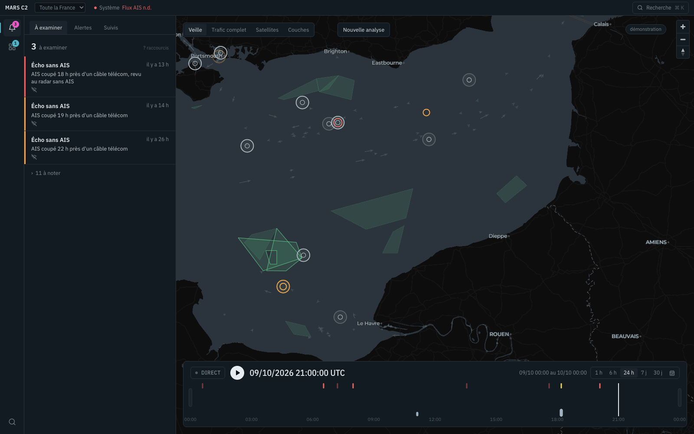
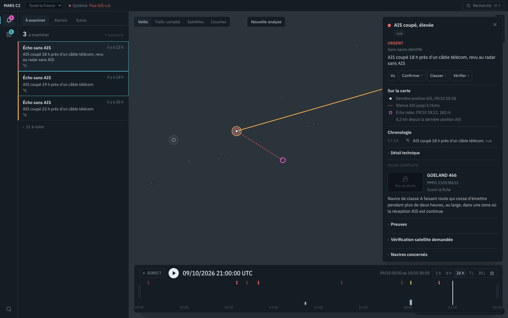
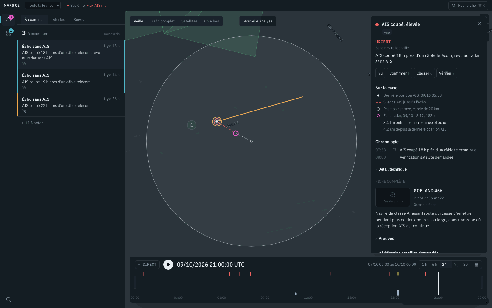
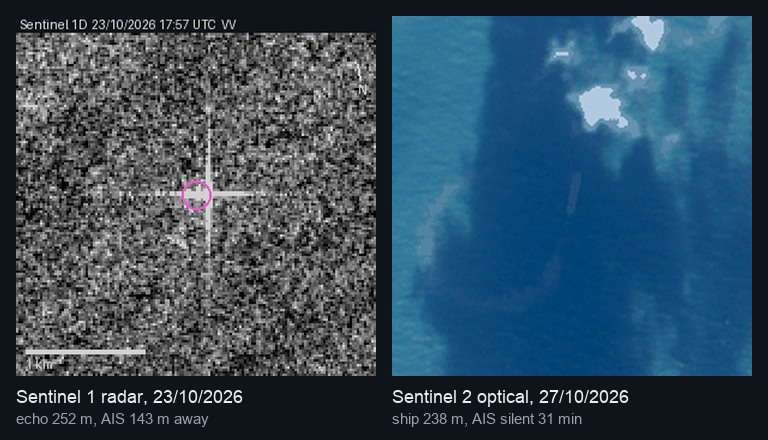
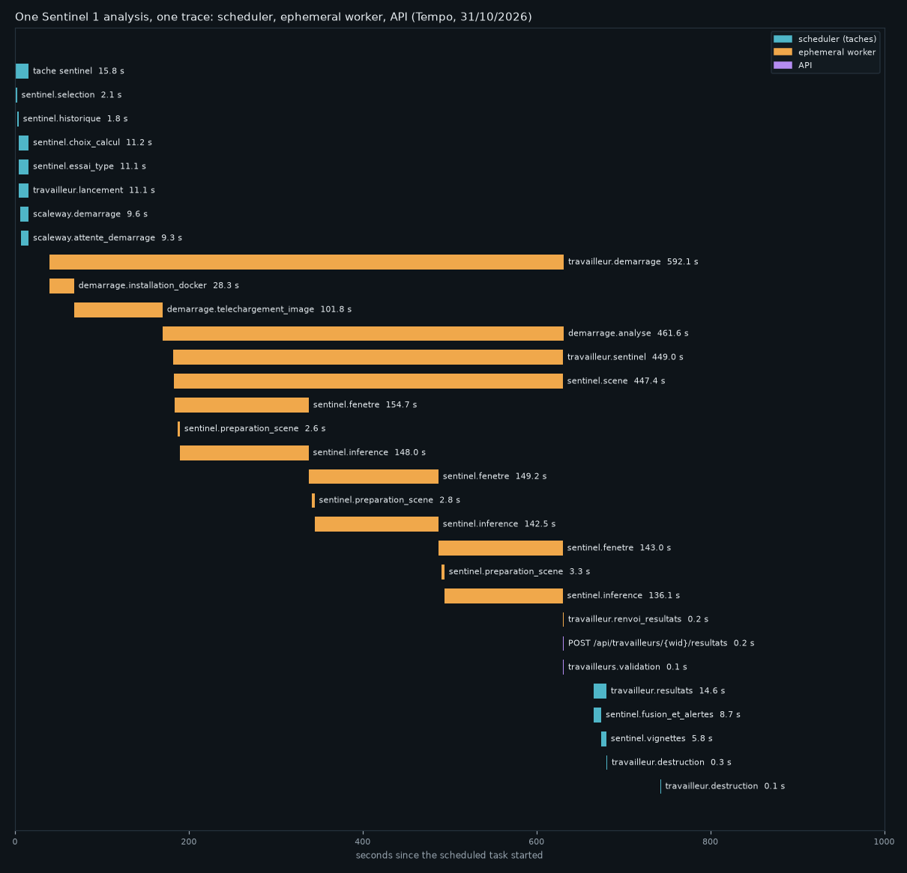
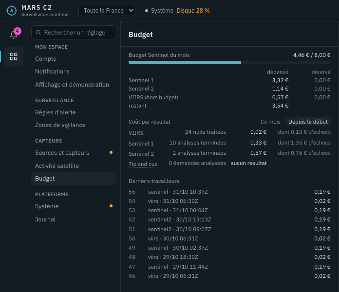
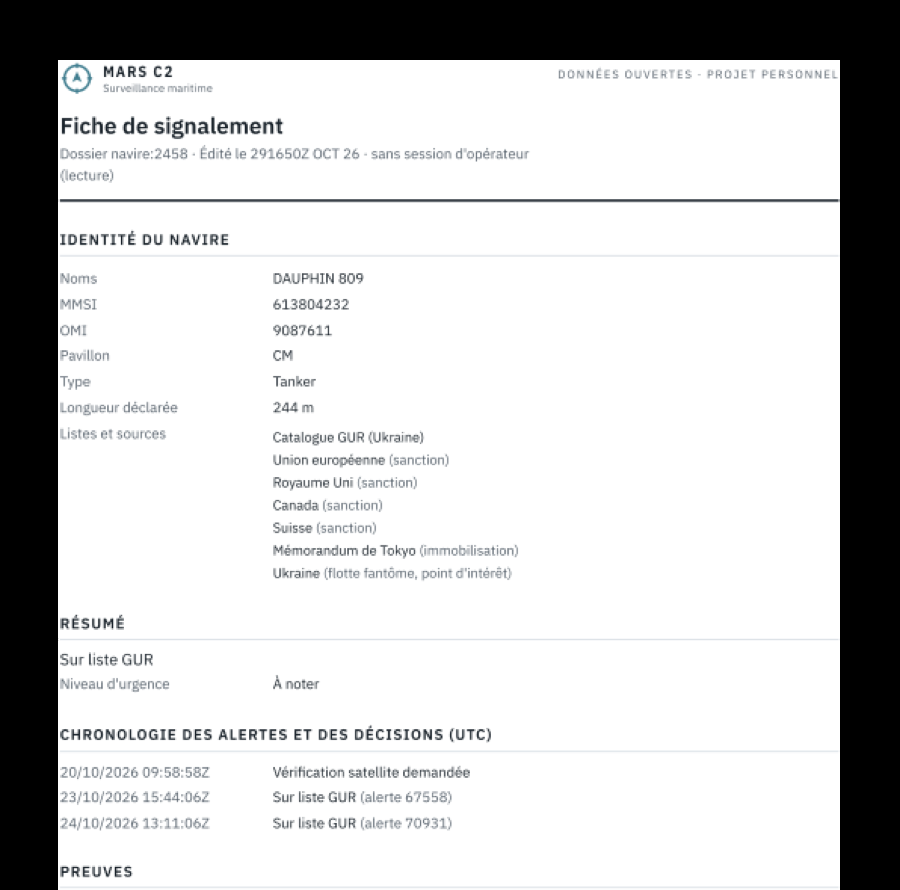
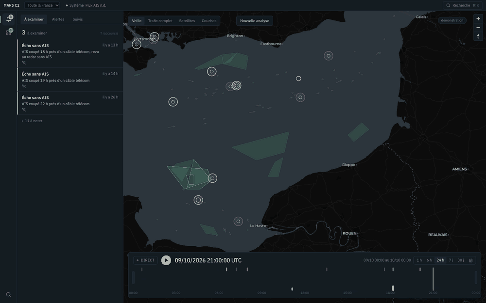
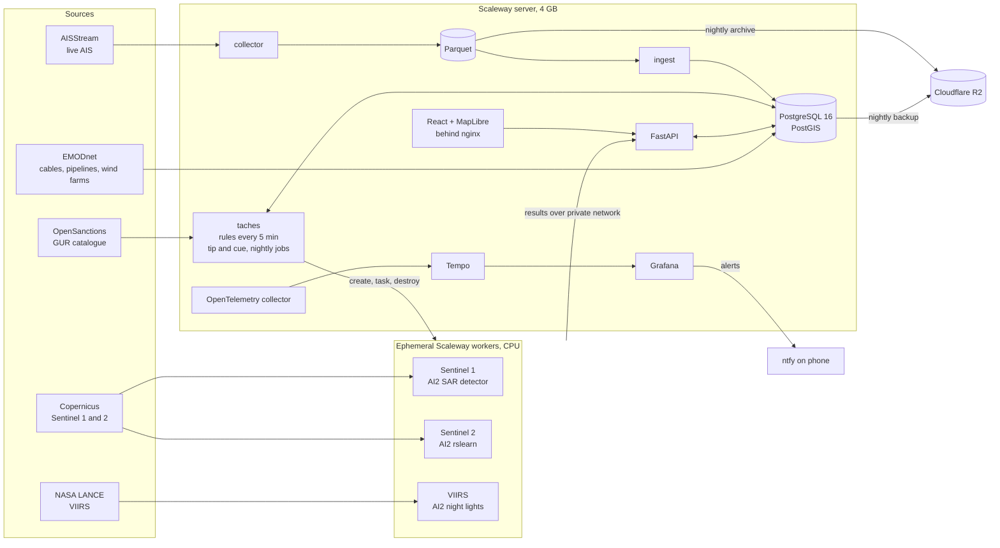

<div align="center">

# MARS C2

**Maritime surveillance for French waters: spot the strange ship before it matters.**

AIS tracking, behavioural rules and satellite cross checks (Sentinel 1 radar, Sentinel 2 optical, VIIRS night lights)
fused into one operator console, run live for a month on a single small cloud server.




<sub>Demonstration mode: vessel names are replaced by stable pseudonyms, no vessel photos.</sub>

</div>

## Why

Undersea cables, power interconnectors, pipelines and offshore wind farms are critical infrastructure, and a ship
dragging its anchor over them looks, on a map, like any other ship. Meanwhile a "shadow fleet" of ageing tankers moves
sanctioned cargo under changing names and flags, sometimes with its transponder switched off.

AIS, the system ships use to broadcast their identity and position, is **declarative**: a ship says who and where it
is. MARS C2 treats every AIS message as a claim to be checked, against behaviour over time and against sensors the
ship does not control.

The imagined user is a French maritime authority watch officer. The question the whole interface is built around:
**which ship should I look at right now, and why?**

## What it does

**1. Watches four French sea areas live.** Brittany (Ushant traffic separation scheme), the Channel, the Bay of Biscay
and the Mediterranean coast including Corsica: about 250 000 kept positions a day, ingested every 15 seconds, kept 30
days in PostGIS and archived every night to object storage.

**2. Runs behavioural rules every five minutes** over a sliding 24 hour window:

| Rule | What it catches |
|---|---|
| `WATCHLIST` | A sanctioned or shadow fleet vessel (OpenSanctions, GUR catalogue) in our waters, matched by IMO number (or by MMSI alone, at a lower severity), with time spent stopped away from port |
| `IDENTITY_CHANGE` | New name confirmed, or the same IMO under another MMSI (flag hopping, simultaneous use) |
| `RENDEZVOUS` | Two ships slow and close for an hour or more, away from the coast: possible ship to ship transfer |
| `AIS_GAP` | A ship under way goes silent inside the area where reception is proven reliable |
| `DARK_SHIP` | A satellite sees a vessel where no AIS was broadcasting |
| `AIS_UNCONFIRMED` | AIS says a ship is here, the satellite sees nothing in a clear, fully read window |
| `IDENTITY_MISMATCH` | The measured length contradicts the declared one |

Every alert links to its evidence, the rules version that produced it and the trace of the computation. Operator
decisions (confirm, dismiss with a reason, follow) survive every recomputation.

**3. Tips and cues satellites.** A suspicious signal (a silence near a cable, a night light with no AIS, an offshore
rendezvous) becomes an observation request. MARS C2 predicts where the ship will be at each upcoming Sentinel pass,
with an uncertainty circle **learned from the archive** (how far ships actually drift from dead reckoning, by speed and
horizon), and only books a pass when the ship is likely enough to be inside the image. An ephemeral cloud worker then
reads just the useful windows of the scene, runs the detector and is destroyed.

**4. Turns alerts into cases.** Alerts are grouped into one case per vessel (or per unidentified echo) with three
urgency levels, a one sentence explanation and the evidence drawn on the map. Keyboard triage: `J` `K` to move, `F`
confirm, `C` dismiss, `S` follow, `V` request a satellite check, `P` print a reporting sheet.

## Screenshots

| | |
|---|---|
|  |  |
| A case opened from the watch list: last AIS position, the silence, the radar echo 4.2 km away. | A satellite check: estimated position at the pass and its uncertainty circle learned from the archive. |



<sub>The same sanctioned tanker at anchor, four days apart: Sentinel 1 radar (left) and Sentinel 2 optical (right).
Thumbnails produced by the workers, exactly as shown to the operator.</sub>



<sub>A real analysis, end to end in one OpenTelemetry trace (about 12 minutes): scene selection, worker creation,
Docker and model download, three windows read and analysed, results posted back, fusion, thumbnails, destruction.
Drawn from the Tempo data of 31/10/2026.</sub>

| | |
|---|---|
|  |  |
| Back office: spend per sensor, cost per useful result, last workers (real figures, 31/10/2026). | A printable A4 reporting sheet built from a case (key `P`), in demonstration mode. |



<sub>Demonstration mode: pseudonyms (names, MMSI and IMO), no vessel photos. The map views were captured on the test
database; the back office on the live server.</sub>

## Architecture



A few design choices worth reading about:

* **Ephemeral workers instead of a GPU server.** Satellite analysis runs on throwaway CPU instances created by the
  server, given their task and credentials once over a private network, then destroyed by a guard that can never touch
  anything else. A Sentinel 1 check costs about 0.19 € and reads only the windows around the points of interest,
  through signed range requests.
* **Everything is traced.** Every task, route, external call and worker step emits OpenTelemetry spans; one satellite
  analysis is one trace, from the scheduled task that launches the worker, through the worker itself, to the results
  received by the API, and an observation request is linked to the alert that caused it.
* **Measure, then simulate, then write.** A silent rule is proven by injection tests on real traffic; every threshold
  carries a version stamped in each alert; every change to stored alerts is first run as a simulation with its
  expected result written down, and operator decisions are never overwritten.
* **Respect the sensor.** No absence is ever declared outside the part of the image actually read, under clouds, or
  outside the area where AIS reception is proven reliable. A detection that cannot be evaluated says so, and a small
  echo far from any lead stays a low priority "small craft, AIS not required under 15 m".

## Proven on real data

Every line below comes from a real satellite scene and the real AIS feed, with the number measured.

| What | Result |
|---|---|
| Radar | A sanctioned tanker at anchor measured at 252 m (244 m declared), its echo 143 m from its AIS position |
| Radar with scene history | Given two earlier passes of the same orbit, the detector found all five ships it had missed on a busy strait scene: 11 detections, exactly the free replay |
| Same ship, optical | Four days later Sentinel 2 sees the same tanker at 238 m in its anchorage; its AIS was silent for 31 minutes, so the system reports "not assessable" instead of a false dark ship |
| First optical true positive | A cargo ship measured at 231 m for 229 m declared |
| Automatic analysis in a dense area | 15 of 18 radar detections matched to their AIS, the scene chosen by the system alone |
| Night lights | VIIRS nights processed by workers with the NASA cloud mask; granules published without it are reprocessed in the evening |
| Offshore transfer | A small vessel alongside three different ships in two days, 25 km offshore, 70 to 90 minutes each: invisible at the Danish 120 minute threshold, caught after recalibration on French traffic |
| Tip and cue | 60 observation requests raised by real alerts since 20 October; the loop (request, pass, analysis, verdict attached to the alert) is built and tested, and two scheduling defects found on real requests are fixed |

## What real data taught us

Each of these was invisible in tests and synthetic data, found on a real run, then fixed and covered by a test on the
real case:

* **The radar model needs history.** Without earlier passes of the same orbit its threshold drops and absences mean
  nothing; the worker now fetches two prior scenes, and says so when it cannot.
* **Geolocation was 80 m off.** Ground control points interpolated linearly drifted inside a scene; a thin plate spline
  fixed it.
* **The night light model was blind under a bright moon.** The cloud mask was never given to it; it is now fetched from
  NASA, and granules published without it are reprocessed when it appears.
* **Matching was too short for ships at anchor.** AIS sends one position every ten minutes for a stopped ship; its last
  position now stays valid for 120 minutes, with a tolerance that grows with time.
* **Observation requests were lost by replanning.** A request left its satellite pass three minutes after the image was
  taken, because the pass was only marked "acquired" overnight; it now keeps its pass while the scene can still be
  published.
* **Cruise ships, wind turbines and a lightship raised false alerts.** Wind farm masks, a prudence rule (a known AIS ship
  that could explain the detection makes the alert low) and a plausible meeting distance (2 km) for watchlist proximity.
* **Real feeds carry junk.** A negative heading from the optical model rejected a whole batch; the placeholder IMO
  `1234567` passes the checksum and linked unrelated ships; both are now handled.

## Some numbers

| | |
|---|---|
| Rules cycle | 18.6 s median every 5 minutes, 626 cycles without failure over the last 7 days |
| Satellite workers, all real runs since 7 October | 55 workers, 5.03 € in total (Sentinel 1 3.32 €, Sentinel 2 1.14 €, VIIRS 0.57 €) |
| One Sentinel 1 check | 0.19 €, about ten minutes of a CPU instance |
| Server | about 19 € a month excluding VAT with network and storage, measured on the invoice |
| Database | 1.9 GB for 30 days of positions; nightly archive about 26 MB a day |
| Interface | about 240 kB of application code, map library cached separately, gzip and long caching |
| Tests | 602 Python tests (with a PostGIS test database) and 42 interface tests, three identical full runs |

## Honest status

This is a completed personal prototype, not a fielded system. It ran live from 6 October to early November 2026.

* **Proven in production:** live AIS collection and ingestion, continuous rules, watchlists, cases and triage,
  supervision with phone alerts, tracing, nightly archive, backup and a tested restore.
* **Proven on a few real scenes:** Sentinel 1 radar (about ten analyses), Sentinel 2 optical (one accepted analysis),
  VIIRS nights.
* **Built, not yet proven end to end on a real request:** the tip and cue verdict attached to an alert.
* **Thresholds** were first calibrated on Danish data, then recalibrated on two to three weeks of French traffic where
  the data allowed; AIS gaps still run in observation mode.

## Tech stack

**Backend** Python 3.12, FastAPI, asyncpg, psycopg, PostgreSQL 16 with PostGIS, Arrow and Parquet, GDAL
**Frontend** React, TypeScript, MapLibre GL, Tailwind, Vite, nginx
**Satellite models** AI2 `vessel-detection-sentinels` (Sentinel 1), AI2 rslearn Sentinel 2 vessel detection, AI2
`vessel-detection-viirs`
**Infrastructure** Docker Compose, Scaleway instances and private network, Cloudflare R2, GitHub Container Registry
**Observability** OpenTelemetry (collector contrib, a small OTLP exporter for the Python 3.8 workers), Grafana Tempo,
Grafana, ntfy

## Repository map

```
mars/          domain code: AIS ingestion, rules, satellites, tip and cue, trajectory, tracing
backend/       FastAPI application
web/           React operator console
travailleurs/  scripts run on ephemeral satellite workers
scripts/       collector, ingestion, scheduled tasks and commands, publish and deploy
db/init/       schema and numbered migrations
config/        versioned rules thresholds
otel/ grafana/ observability configuration, dashboards as code
docs/          design notes, measurements, audit and final report (in French)
```

The design notes in `docs/` are written in French; the index is `docs/README.md`. Good entry points:
`docs/rapport_final.md`, `docs/audit_final.md`, `docs/travailleurs.md`, `docs/regles_alertes.md`,
`docs/opentelemetry.md` and `docs/exploitation.md`.

## How it was built

Designed and directed by Antoine de Pommereau, written with an AI coding assistant (Claude Code), with one method
throughout: measure on real data, simulate the change, then apply it, and keep a dated journal (`docs/journal.md`).

## Data sources and licences

AIS from AISStream; sanctions from OpenSanctions; Ukrainian GUR shadow fleet catalogue; Copernicus Sentinel data
(contains modified Copernicus Sentinel data); NASA LANCE VIIRS near real time products; EMODnet Human Activities;
GSHHG coastlines. Models from the Allen Institute for AI under Apache 2.0. Historical AIS datasets used for training
(Danish Maritime Authority, GeoTrackNet Brittany, École navale) are used for personal, non commercial research only and
are not redistributed, nor are any derived datasets or weights. Vessel photos, shown only outside demonstration mode,
are fetched on demand from VesselFinder for personal use.

## En français

MARS C2 est une plateforme de surveillance maritime pour les eaux françaises : elle confronte l'AIS déclaratif au
comportement des navires et à des capteurs satellitaires indépendants (radar Sentinel 1, optique Sentinel 2, lumières
nocturnes VIIRS) pour protéger les infrastructures sous marines et suivre la flotte fantôme. Projet personnel
d'Antoine de Pommereau, mené jusqu'à un prototype complet en service réel pendant un mois ; la documentation détaillée
du dossier `docs/` est en français, à commencer par `docs/rapport_final.md`.

---

<sub>Built by Antoine de Pommereau. Not affiliated with any French government agency.</sub>
