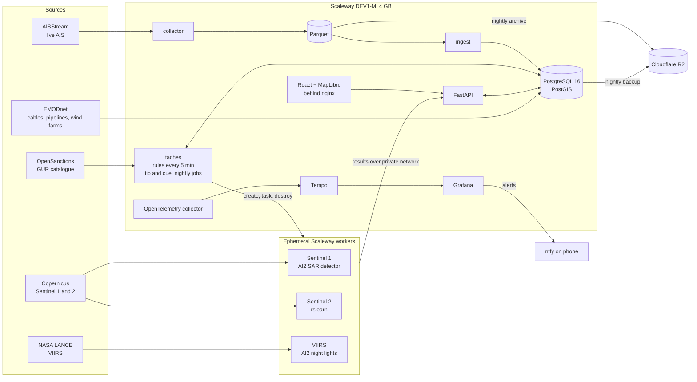

<div align="center">

# MARS C2

**Maritime surveillance for French waters: spot the strange ship before it matters.**

AIS tracking, behavioural rules and satellite cross checks (Sentinel 1 radar, Sentinel 2 optical, VIIRS night lights)
fused into one operator console, running live on a single 4 GB server for about 20 € a month.


<sub>Demonstration mode: vessel names are replaced by stable pseudonyms.</sub>

</div>

## Why

Undersea cables, power interconnectors, pipelines and offshore wind farms are critical infrastructure, and a ship
dragging its anchor over them looks, on a map, like any other ship. Meanwhile a "shadow fleet" of ageing tankers moves
sanctioned cargo under changing names and flags, sometimes with its transponder switched off.

AIS, the system ships use to broadcast their identity and position, is **declarative**: a ship says who and where it
is. MARS C2 treats every AIS message as a claim to be checked, and checks it against behaviour over time and against
sensors the ship does not control.

The imagined user is a French maritime authority watch officer (navy, coast guard, customs). The question the whole
interface is built around: **which ship should I look at right now, and why?**

## What it does

**1. Watches four French sea areas live.** Brittany (Ushant traffic separation scheme), the Channel, the Bay of Biscay
and the Mediterranean coast including Corsica: about 680 AIS messages per minute, ingested every 15 seconds, kept 30
days in PostGIS and archived daily to object storage.

**2. Runs behavioural rules every five minutes** over a sliding 24 hour window:

| Rule | What it catches |
|---|---|
| `WATCHLIST` | A sanctioned or shadow fleet vessel (OpenSanctions, GUR catalogue) in our waters, matched by IMO number (or by MMSI alone, at a lower severity), with time spent stopped away from port |
| `IDENTITY_CHANGE` | New name confirmed, or the same IMO under another MMSI (flag hopping, simultaneous use) |
| `RENDEZVOUS` | Two ships slow and close for hours, away from the coast: possible ship to ship transfer |
| `AIS_GAP` | A ship under way goes silent inside the area where reception is proven reliable |
| `DARK_SHIP` | A satellite sees a vessel where no AIS was broadcasting |
| `AIS_UNCONFIRMED` | AIS says a ship is here, the radar sees nothing |
| `IDENTITY_MISMATCH` | The radar measured length contradicts the declared one |

Every alert links to its evidence, the rules version that produced it and the trace of the computation. Operator
decisions (confirm, dismiss with a reason, follow) survive every recomputation.

**3. Tips and cues satellites.** A suspicious signal (a silence near a cable, a night light with no AIS, an offshore
rendezvous) becomes an observation request. MARS C2 predicts where the ship will be at each upcoming Sentinel pass,
with an uncertainty circle **learned from the archive** (how far ships actually drift from dead reckoning, by speed and
horizon), and only books a pass when the ship is likely enough to be inside the image. An ephemeral cloud worker then
reads just the useful windows of the scene, runs the detector and is destroyed.

**4. Turns alerts into cases.** Alerts are grouped into one case per vessel (or per unidentified echo) with three urgency levels, a one sentence
explanation and the evidence drawn on the map. Keyboard triage: `J` `K` to move, `F` confirm, `C` dismiss, `S` follow,
`V` request a satellite check.

## Screenshots

| | |
|---|---|
|  |  |
| A case opened from the watch list: last AIS position, the silence, the radar echo 4.2 km away. | A satellite check: estimated position at the pass and its uncertainty circle learned from the archive. |


<sub>Demonstration mode on the test database: pseudonyms, no vessel photos.</sub>

## Architecture



A few design choices worth reading about:

* **Ephemeral workers instead of a GPU server.** Satellite analysis runs on throwaway instances created by the API,
  given their task and credentials once over a private network, then destroyed by the server with a guard that can
  never touch anything else. A Sentinel 1 check on CPU costs about 0.19 € and reads under 2 % of the scene through
  signed range requests.
* **Everything is traced.** Every task, route, external call and worker step emits OpenTelemetry spans; one satellite
  analysis is one trace, from the scheduled task that launches the worker, through the worker itself, to the results
  received by the API. Sensitive data is filtered twice, in code and in the collector.
* **Measure, don't assert.** A silent rule is proven by injection tests on real traffic; thresholds carry a version
  stamped in each alert; performance claims in the docs come with their measurement.
* **Respect the sensor.** No absence is ever declared outside the part of the image actually read, under clouds, or
  outside the area where AIS reception is proven reliable. A detection that cannot be evaluated says so.

## Some numbers

| | |
|---|---|
| Rules cycle | 18.8 s every 5 minutes, 688 consecutive cycles without failure |
| AIS gap rule after query rework | 92 s down to 0.9 s, same results |
| Learned uncertainty circle | ship actually inside it 63 % of the time at 3 hours, versus 19 % before (pre measurement, 17 to 22 October 2026) |
| Satellite check booking guard | 40 % minimum probability of containment, about 2.45 € a month |
| Operator task "understand why this ship is flagged" | about 41 s down to 6 to 8 s after the UX rework |
| Server | Scaleway DEV1-M, 0.0202 € per hour (about 14.7 € a month) |
| Network and storage | about 4 € a month, measured on the Scaleway invoice |
| Satellite workers | from a few cents to 0.19 € per analysis |
| Running cost | about 19 € a month excluding VAT in steady state, measured |
| Tests | 480 passing (pytest, with a PostGIS test database), plus type checks and frontend tests |

## Honest status

This is a personal project and a live prototype, not a fielded system.

* **Proven in production:** live AIS collection and ingestion, continuous rules, watchlists, cases and triage,
  supervision with phone alerts, tracing, nightly archive and backup.
* **Built and tested, few real runs so far:** VIIRS nights (12 processed by real workers), Sentinel 1 analysis (one real
  scene analysed end to end on CPU), tip and cue (20 real observation requests, none observed yet).
* **Built, not yet proven on real data:** Sentinel 2 optical detection, and the radar alerts (`DARK_SHIP` from radar,
  `AIS_UNCONFIRMED`, `IDENTITY_MISMATCH`), never raised on real data so far.
* **Thresholds** were first calibrated on Danish data and are being recalibrated on French traffic; AIS gaps run in
  observation mode until then.
* **Next:** trajectory forecasting (TrAISformer for 1 to 3 hours, route hypotheses for 12 to 30 hours) to anticipate
  rather than only detect.

## Tech stack

**Backend** Python 3.12, FastAPI, asyncpg, PostgreSQL 16 with PostGIS, Arrow and Parquet, GDAL and rasterio
**Frontend** React, TypeScript, MapLibre GL, Tailwind, Vite, nginx
**Satellite models** AI2 `vessel-detection-sentinels` (Sentinel 1), AI2 rslearn Sentinel 2 vessel detection, AI2
`vessel-detection-viirs`
**Infrastructure** Docker Compose, Scaleway instances and private network, Cloudflare R2, GitHub Container Registry
**Observability** OpenTelemetry (collector contrib, custom stdlib OTLP exporter for Python 3.8 workers), Grafana Tempo,
Grafana, ntfy

## Repository map

```
mars/          domain code: AIS ingestion, rules, satellites, tip and cue, trajectory, tracing
backend/       FastAPI application
web/           React operator console
travailleurs/  scripts run on ephemeral satellite workers
scripts/       collector, ingestion, scheduled tasks and commands
db/init/       schema and numbered migrations
config/        versioned rules thresholds
otel/ grafana/ observability configuration, dashboards as code
docs/          design notes and measurements (in French)
```

The design notes in `docs/` are written in French; start with `docs/sentinel.md`, `docs/trajectoire.md`,
`docs/opentelemetry.md`, `docs/ux_refonte.md` and `docs/exploitation.md`.

## Data sources and licences

AIS from AISStream; sanctions from OpenSanctions; Ukrainian GUR shadow fleet catalogue; Copernicus Sentinel data
(contains modified Copernicus Sentinel data); NASA LANCE VIIRS near real time products; EMODnet Human Activities;
GSHHG coastlines. Models from the Allen Institute for AI under Apache 2.0. Historical AIS datasets used for training
(Danish Maritime Authority, GeoTrackNet Brittany, École navale) are used for personal, non commercial research only and
are not redistributed, nor are any derived datasets or weights. Vessel photos are fetched on demand from VesselFinder,
for personal use.

## En français

MARS C2 est une plateforme de surveillance maritime pour les eaux françaises : elle confronte l'AIS déclaratif au
comportement des navires et à des capteurs satellitaires indépendants (radar Sentinel 1, optique Sentinel 2, lumières
nocturnes VIIRS) pour protéger les infrastructures sous marines et suivre la flotte fantôme. Projet personnel
d'Antoine de Pommereau ; la documentation détaillée du dossier `docs/` est en français.

---

<sub>Built by Antoine de Pommereau. Not affiliated with any French government agency.</sub>
