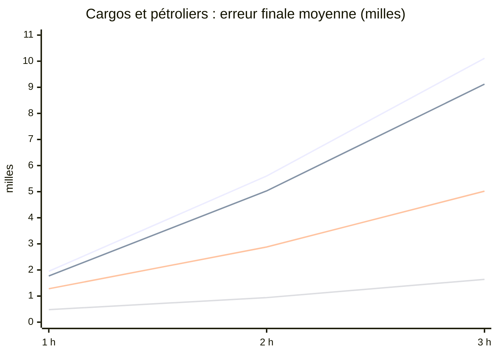

# Lot T : prévision de trajectoire, phase 1 (22/10/2026)

Données, faisabilité et référence avant tout modèle. Aucune construction de modèle avant la validation d'Antoine.
Code de mesure : `mars/trajectoire.py` (préparation et références, pur), `mars/trajectoire_mesures.py` (archive R2),
commande `taches.py trajectoire-mesures` (lecture seule, tracée), tests `tests/test_trajectoire*.py`.

## En bref

* **Le besoin réel de la vérification satellite est à 12 à 30 h, pas à 1 à 3 h.** Sur les 20 demandes du serveur
  depuis le 06/10, 13 se sont terminées « sans passage » parce que le prochain passage tombait 13 à 31 h après la
  dernière position, au delà des 6 h de l'estime. Un modèle évalué à 1, 2 et 3 h ne règle pas ce cas.
* **La référence à battre** (cargos et pétroliers, période tenue à l'écart, échantillon du serveur) : erreur finale
  médiane de 1,1 km à 1 h, 3,8 km à 2 h, 10,4 km à 3 h pour le suivi des routes fréquentes, un peu mieux que l'estime
  actuelle (1,3, 5,2, 13,0 km). En moyenne : 1,8, 5,0 et 9,1 milles, contre 0,48, 0,94 et 1,64 mille pour TrAISformer
  dans l'article (meilleur de 16 tirages, détroits danois) et 1,28, 2,88 et 5,02 pour sa version à un seul tirage.
* **Le cercle actuel de la vérification satellite est trop petit** : à 3 h, il ne contient que 52 % des positions
  réelles des cargos et pétroliers, et 49 % de celles de tous les navires entre 5 et 10 nœuds. Pour en contenir 80 %,
  il faudrait 24 à 35 km de rayon selon la vitesse.
* **Volume** : seule la Manche atteint un volume comparable à l'article à court terme (de mi novembre à mi décembre
  2026, environ 150 à 300 trajets de cargos et pétroliers par jour). La Gascogne demande de 8 à 16 mois, la Bretagne et
  la Méditerranée plusieurs années : elles dépendront du pré entraînement externe.
* **Données externes prêtes** : le jeu publié de GeoTrackNet couvre exactement notre zone Bretagne (récepteur
  d'Ouessant, 2017, 7 827 trajets d'entraînement) ; l'archive DMA est ouverte et à jour (jusqu'au 19/10/2026).
* **Calcul** : un entraînement de l'ordre de l'article coûte environ 0,4 € sur un L4 (13 minutes), ou 4 h sur le GPU
  du MacBook Air ; l'inférence tient sur le processeur du serveur en ONNX pour les usages a et b.

## 1. TrAISformer : article et code

Nguyen et Fablet, « TrAISformer, a generative transformer for AIS trajectory prediction » (arXiv 2109.03958), code
`CIA-Oceanix/TrAISformer`, licence **CECILL C** (compatible avec un usage dans MARS C2, modifications du code publiées si
le logiciel est distribué).

| Élément | Article et code |
|---|---|
| Données | DMA, cargos et pétroliers, 01/01/2019 au 31/03/2019, zone de 55,5 à 58,0 N et 10,3 à 13,0 E, 712 millions de messages bruts |
| Découpage | entraînement jusqu'au 10/03, validation du 11 au 20/03, test du 21 au 31/03 |
| Prétraitement | vitesse de 30 nœuds ou plus écartée ; navires amarrés ou au mouillage écartés ; positions à moins d'un mille de la côte écartées ; coupure après 2 h de silence ; trajets d'au moins 20 messages et 4 h ; saut de plus de 40 nœuds écarté ; échantillonnage à 10 minutes ; trajets coupés à 20 h |
| Jeu publié (`data/ct_dma`) | 10 605 trajets d'entraînement (2 517 navires, 769 184 points), 1 481 de validation, 1 593 de test (11 jours) ; trajets de 4 à 24 h, médiane 12 h ; format `[lat, lon, sog, cog, instant, mmsi]` normalisé dans la zone |
| Modèle | transformer de 8 couches et 8 têtes, plongement de 768 (environ 58 millions de paramètres), position en grille de 0,01 degré, vitesse au nœud, route par 5 degrés ; perte d'entropie croisée multi résolution |
| Entraînement | 50 époques, GTX 1080 Ti ; 3 h d'historique, horizon jusqu'à 15 h ; 60 min pour 10 jours de test |
| Mesure | erreur de distance moyenne, **meilleur de 16 tirages** |
| Résultats (milles) | TrAISformer 0,48, 0,94, 1,64 à 1, 2, 3 h ; GeoTrackNet 0,72, 1,59, 2,67 ; TrAISformer à un seul tirage 1,28, 2,88, 5,02 ; sous 10 milles jusqu'à 9,7 h |

**Réserve** : le « meilleur de 16 » choisit après coup le tirage le plus proche de la vérité. Pour viser un passage
satellite, il faut une seule prévision et une zone d'incertitude, ou plusieurs modes chacun avec sa probabilité : la
mesure utile pour nous est celle du tirage unique et de la couverture d'un cercle (ou de plusieurs fenêtres).

Notre préparation (`mars/trajectoire.py`) reprend ces règles, plus deux coupures : changement de destination, et
saut durable (deux navires sous un même MMSI).

## 2. Notre archive

**Format** (mars/archive.py) : sur R2, un Parquet zstd par type (positions, statiques), zone et jour, trié par navire
puis par instant (`ais/positions/zone=…/date=…/…parquet`), inscrit dans la table `archives` (lignes, octets, MD5).
Champs des positions : mmsi, instant (texte AISStream, décimales de longueur variable), lat, lon, sog, cog, cap,
statut de navigation, classe B, zone, source. Statiques : nom, OMI, indicatif, type AIS, longueur, destination.
Environ 26 Mo par jour pour les quatre zones (27,4 octets par position).

**Continuité, d'après la frise du serveur** (lecture en GET) : toutes les journées du 06 au 21/10 ont des données
dans les quatre zones ; une seule coupure générale du flux de plus de 30 minutes, le 14/10 de 10:18 à 12:59 (2 h 41).
L'incident du 18/10 n'apparaît pas dans les statistiques du flux : la commande de mesure dira si des objets manquent
sur R2. En Bretagne, le nombre de navires par heure baisse à partir du 16/10 (de 130 à 145 à environ 100).

| Navires par heure (moyenne journalière, du 06 au 21/10) | Bretagne | Manche | Gascogne | Méditerranée |
|---|---|---|---|---|
| plage | 97 à 148 | 598 à 864 | 132 à 224 | 316 à 458 |

### Pré mesure sur un échantillon (lecture seule, en GET)

La mesure complète lit l'archive R2, ce que seul le serveur peut faire (jeton filtré sur son IP). En attendant, une
pré mesure a été faite sur le Mac à partir de positions lues par l'API du serveur (tunnel, GET seulement) :
* **flotte** : instantanés toutes les 6 h du 06 au 21/10, 10 820 navires vus, 2 847 en route au moins trois fois ;
* **échantillon** : jusqu'à 15 navires par zone et par catégorie, les plus souvent en route (340 navires, 517 364
  positions de la base, déjà allégées à une par minute en route) ;
* **côte** : table `land` de la base de test (même source GSHHG que le serveur) ;
* **limites** : échantillon biaisé vers les navires actifs ; le GPX ne porte pas la vitesse déclarée, remplacée par
  la vitesse mesurée entre deux positions ; pas de coupure au changement de destination.

| Trajets exploitables (4 h au moins, hors côte) | Total | Médiane de durée | 90e centile |
|---|---|---|---|
| échantillon, 16 jours | 1 483 | 7,5 h | 17,8 h |

| Fin des trajets | Silence de 2 h | Approche de la côte | Arrêt | Fin des données |
|---|---|---|---|---|
| part | 37 % | 30 % | 27 % | 6 % |

**Continuité** : 89 % des silences qui coupent un trajet surviennent à plus de 10 km de la côte. Ce sont des trous
de réception d'AISStream au large plus que des navires qui se taisent : le trajet utilisable s'arrête là où notre
couverture s'arrête. Sur 13 147 segments, 9 233 font moins de 4 h une fois rééchantillonnés.

| Flotte en route (06 au 21/10) | Bretagne | Manche | Gascogne | Méditerranée |
|---|---|---|---|---|
| cargos | 63 | 715 | 119 | 74 |
| pétroliers | 26 | 326 | 45 | 10 |
| passagers | 23 | 131 | 17 | 64 |
| pêche | 68 | 245 | 100 | 34 |
| autres | 210 | 395 | 84 | 98 |

### Projection : quand atteindre le volume de l'article

Volume de référence : les 10 605 trajets d'entraînement de cargos et pétroliers du jeu publié (69 jours dans une zone
de 2,5 par 2,7 degrés, environ 154 par jour). Taux mesuré sur l'échantillon (trajets de cargos et pétroliers par
navire et par jour), appliqué à la flotte en route ; fourchette haute telle quelle, basse divisée par deux (biais de
l'échantillon vers les navires actifs). Point de départ : 06/10/2026.

| Zone | Trajets par jour (bas à haut) | Volume de l'article atteint |
|---|---|---|
| Manche | 155 à 310 | 09/11/2026 au 13/12/2026 |
| Gascogne | 22 à 43 | 06/2027 à 02/2028 |
| Méditerranée | 8 à 16 | 08/2028 à 07/2030 |
| Bretagne | 6 à 11 | 05/2029 à 11/2031 |

La Bretagne (rail d'Ouessant) est peu reçue par AISStream : son volume viendra du jeu GeoTrackNet (même zone) et de
l'affinage à partir d'un modèle pré entraîné. La mesure complète remplacera ces chiffres par ceux de l'archive.

## 3. Données d'entraînement externes

| Jeu | Disponibilité (22/10/2026) | Licence | Format, volume, période | Réutilisable par TrAISformer |
|---|---|---|---|---|
| **DMA** (Danish Maritime Authority) | seau S3 public `aisdata.ais.dk` : mois de 2006 à 2024, puis un fichier par jour du 27/02/2025 au 19/10/2026 | données publiques réutilisables (loi danoise sur la réutilisation des informations du secteur public) ; pas de licence écrite sur le seau : à vérifier | CSV zippés de 26 colonnes (horodatage, MMSI, position, vitesse, route, cap, type, dimensions, destination) ; 2019 : 16 à 18 Go par mois ; 2025 : environ 0,5 Go par jour | oui, par le script de préparation de GeoTrackNet (`csv2pkl.py`) ou le nôtre ; le jeu traité de l'article est déjà dans le dépôt (49 Mo) |
| **GeoTrackNet, Bretagne** (CLS, récepteur d'Ouessant) | dans le dépôt `CIA-Oceanix/GeoTrackNet` (`ct_2017010203_10_20.zip`, 41 Mo) | code MIT ou CECILL C ; données fournies par CLS, conditions de réutilisation à confirmer (jeu complet 2011 à 2019 sur demande à CLS) | cargos et pétroliers, 01/01 au 31/03/2017, zone de 47,5 à 49,5 N et 7 à 4 W (notre zone Bretagne), pas de 5 minutes ; 7 827 trajets d'entraînement, 1 193 de validation, 1 271 de test | oui, format voisin (positions normalisées dans la zone) ; rééchantillonnage à 10 minutes à faire |
| **École navale** (Ray et al., Zenodo 1167595) | en ligne, « AIS Data.zip » de 201 Mo | **CC BY NC SA 4.0** : usage non commercial | Brest, d'octobre 2015 à mars 2016, un récepteur côtier, environ 19 millions de positions, tous types | après préparation (nos règles) ; la clause non commerciale l'exclut d'un usage pour un client |

**Écart de domaine** : la DMA et le récepteur d'Ouessant sont des réseaux côtiers denses (positions toutes les
quelques secondes, peu de trous) ; AISStream est un agrégat de récepteurs bénévoles, avec de longs trous au large
(89 % des silences). Le trafic danois (détroits, ferries, voies du Kattegat) diffère de la Manche (dispositif de
séparation du trafic, flux est ouest massif) et de la Méditerranée. Les types : l'article se limite aux cargos et
pétroliers ; nos usages concernent aussi la pêche et les autres types (navires des listes de toute nature).

**Stratégie proposée** : pré entraînement sur la DMA (plusieurs mois, cargos et pétroliers puis tous types) et sur
GeoTrackNet Bretagne ; affinage par zone sur notre archive avec des trous simulés à l'entraînement (positions
retirées comme le fait AISStream) ; évaluation uniquement sur nos données françaises, sur une période tenue à l'écart.

## 4. Référence avant tout modèle

Trois prédicteurs simples, sur des fenêtres de 3 h d'historique et 3 h à prévoir (une par heure de trajet), routes
apprises avant le 17/10, évaluation du 17 au 22/10 (394 trajets de test, 1 762 fenêtres, 135 navires) :
* **estime** : dernière vitesse et dernière route (celles de la vérification satellite actuelle) ;
* **estime mesurée** : vitesse et route mesurées entre les deux dernières positions ;
* **routes fréquentes** : grille de 0,02 degré, huit secteurs de cap d'arrivée ; dans une cellule fréquentée, cap de
  sortie moyen du trafic d'entraînement (les virages des routes sont appris), vitesse constante.

**Cargos et pétroliers** (437 fenêtres, 52 navires), erreur finale en km : médiane / moyenne / 90e centile

| Prédicteur | 1 h | 2 h | 3 h | Moyenne en milles (1, 2, 3 h) |
|---|---|---|---|---|
| Estime | 1,3 / 3,6 / 10,7 | 5,2 / 10,4 / 27,3 | 13,0 / 18,7 / 43,3 | 1,95 ; 5,60 ; 10,11 |
| Estime mesurée | 1,1 / 3,4 / 10,1 | 5,1 / 10,0 / 25,1 | 12,7 / 18,2 / 41,9 | 1,84 ; 5,39 ; 9,82 |
| Routes fréquentes | 1,1 / 3,3 / 9,0 | 3,8 / 9,3 / 24,3 | 10,4 / 16,9 / 41,6 | 1,77 ; 5,03 ; 9,12 |
| TrAISformer, article (meilleur de 16) | | | | 0,48 ; 0,94 ; 1,64 |
| TrAISformer, article (un tirage) | | | | 1,28 ; 2,88 ; 5,02 |

Erreur moyenne sur le trajet (ADE), routes fréquentes : 1,6, 4,1 et 7,3 km à 1, 2 et 3 h.

Lignes, de haut en bas : estime, routes fréquentes, TrAISformer à un tirage (article), TrAISformer meilleur de 16
(article). Les chiffres de l'article viennent des détroits danois, couverts sans trou : à confirmer sur nos données.

**Médiane de l'erreur finale à 1, 2, 3 h (km), estime puis routes fréquentes**

| Groupe | Fenêtres | Estime | Routes fréquentes |
|---|---|---|---|
| Bretagne | 58 | 3,9 ; 11,5 ; 16,9 | 2,8 ; 9,8 ; 16,6 |
| Manche | 1 212 | 5,0 ; 11,6 ; 18,0 | 4,3 ; 9,9 ; 15,5 |
| Gascogne | 275 | 2,3 ; 9,1 ; 15,8 | 2,2 ; 8,4 ; 14,5 |
| Méditerranée | 217 | 1,6 ; 5,1 ; 13,4 | 1,3 ; 4,6 ; 10,8 |
| Cargos | 278 | 1,2 ; 4,4 ; 11,2 | 1,0 ; 3,8 ; 10,4 |
| Pétroliers | 159 | 1,6 ; 7,1 ; 14,9 | 1,4 ; 3,9 ; 10,4 |
| Passagers | 93 | 1,2 ; 3,2 ; 6,6 | 1,0 ; 2,9 ; 4,9 |
| Pêche | 806 | 5,5 ; 12,5 ; 19,1 | 5,1 ; 11,1 ; 16,9 |
| 5 à 10 nœuds | 261 | 1,8 ; 7,1 ; 14,6 | 1,6 ; 6,6 ; 14,9 |
| 10 à 15 nœuds | 209 | 1,3 ; 4,7 ; 13,0 | 1,3 ; 3,3 ; 8,8 |
| 15 à 25 nœuds | 89 | 1,8 ; 6,3 ; 13,9 | 1,1 ; 3,4 ; 6,0 |

Les routes fréquentes gagnent surtout sur les navires rapides (15 à 25 nœuds : 6,0 km au lieu de 13,9 à 3 h) et sur
les pétroliers à 2 h ; elles ne font rien pour la pêche (trajets sans route). La Manche est la plus difficile, à cause
de la pêche et des traversées courtes.

**Cercle actuel de la vérification satellite** (2 km plus 30 % de la distance parcourue, borné à 30 km) : part des
positions réelles qu'il contient, et rayon qui en aurait contenu 80 %.

| Vitesse | Horizon | Rayon actuel moyen | Couverture actuelle | Rayon pour 80 %, estime | Rayon pour 80 %, routes |
|---|---|---|---|---|---|
| 5 à 10 nœuds | 1 h | 6,2 km | 74 % | 8,9 km | 8,3 km |
| 5 à 10 nœuds | 3 h | 14,6 km | 49 % | 37,9 km | 35,3 km |
| 10 à 15 nœuds | 1 h | 8,8 km | 87 % | 5,4 km | 4,2 km |
| 10 à 15 nœuds | 3 h | 22,3 km | 68 % | 34,7 km | 31,5 km |
| 15 à 25 nœuds | 1 h | 11,2 km | 94 % | 6,1 km | 2,9 km |
| 15 à 25 nœuds | 3 h | 28,9 km | 72 % | 32,6 km | 23,7 km |

Le cercle actuel est trop large à 1 h pour les navires rapides et trop petit à 3 h pour tous : un cercle appris par
horizon et par vitesse (quantiles mesurés) ferait déjà mieux, avant tout modèle.

## 5. Plan de calcul et coût

**Entraînement.** Un entraînement de l'ordre de l'article : environ 58 millions de paramètres, 38 millions de positions
vues (50 époques de 770 000), soit 1,3 × 10^16 opérations.

| Où | Durée estimée | Coût | Remarques |
|---|---|---|---|
| L4 éphémère (Scaleway, `fr-par-2`) | 13 min de calcul, plus environ 15 min de démarrage | 0,4 € par entraînement (0,79 € de l'heure, à la minute) | rupture de stock constatée le 16/10 : attente et reprise déjà codées pour Sentinel 1 ; L40S en secours (1,47 €/h) |
| GPU du MacBook Air (MPS) | 4 h environ | aucun | sans ventilateur : ralentissement thermique probable ; convient aux essais sur un mois de données |
| Processeur du Mac | 12 h environ | aucun | à éviter |
| Serveur | non | | 4 Go, conteneur de 768 Mo : ni entraînement ni extraction lourde |

Une campagne d'essais (une dizaine d'entraînements, pré entraînement DMA compris) reste sous 10 €, hors du budget
Sentinel (8 € par mois) ou dans un budget à part, à décider.

**Chemin des données.**
1. Sur le serveur, une commande d'extraction (phase 2) produit les trajets rééchantillonnés à 10 minutes en Parquet
   compact (instant, lat, lon, vitesse, route, mmsi, type), par zone et par semaine, avec la même préparation que la
   mesure. Environ 8 octets par point en zstd : de l'ordre de 1,5 Mo par jour pour les quatre zones, 0,5 Go par an.
2. Le Parquet est déposé dans le seau des modèles (`mars-c2-modeles`), jamais dans le seau principal accessible par
   le seul jeton du serveur ; le Mac ou le travailleur GPU le lit par une adresse présignée signée par le serveur.
3. Coût R2 : négligeable (0,5 Go par an dans les 10 Go gratuits, aucune sortie facturée).
4. Les données externes (DMA, GeoTrackNet) sont téléchargées et préparées sur le Mac (trois mois de DMA 2025 : environ
   54 Go à télécharger, mesuré le 22/10/2026, quelques Go une fois réduits).

**Inférence**, selon les usages (modèle exporté en ONNX : pas de torch dans l'image des scripts, environ 250 Mo de
mémoire pour 58 millions de paramètres) :

| Usage | Fréquence | Volume | Où |
|---|---|---|---|
| a. Vérification satellite | à chaque demande (quelques par jour) | 1 navire, 16 tirages | serveur, processeur (quelques secondes) |
| b. Score d'anomalie | à chaque cycle des dossiers | les navires des dossiers (dizaines) | serveur, processeur |
| c. Anticipation | toutes les 10 à 15 minutes | navires des listes et navires lents près des câbles (une centaine), pas toute la flotte | serveur si le modèle tient en quelques secondes par navire ; sinon modèle réduit, ou travailleur |

## 6. Risques

1. **Horizon de l'usage a** : les passages tombent 13 à 31 h après la dernière position. À ces horizons, l'article
   dépasse 10 milles d'erreur après 9,7 h ; il faudra des prévisions à plusieurs modes, chacun une fenêtre satellite
   (quatre fenêtres par demande sont déjà permises), et accepter un taux de réussite modeste.
2. **Trous de réception** : 89 % des silences sont au large ; le modèle reçoit des historiques troués et s'entraîne
   sur des trajets courts (médiane 7,5 h). Entraînement avec trous simulés nécessaire.
3. **Volume** : hors Manche, nos données ne suffiront pas avant 2027 ou plus ; tout repose sur le pré entraînement.
4. **Mesure optimiste de l'article** (meilleur de 16) : il faut comparer à un tirage unique et à une couverture.
5. **Licences** : clause non commerciale de l'École navale ; conditions de CLS pour GeoTrackNet ; absence de licence
   écrite sur le seau de la DMA.
6. **Serveur** : mémoire juste (768 Mo pour le conteneur des tâches) ; l'inférence doit passer par ONNX ; la mesure
   complète doit tourner dans un conteneur à part.
7. **Stock des L4** chez Scaleway.
8. **Saisons** : notre archive commence le 06/10/2026 ; l'hiver, la pêche et les routes changent.

## 7. Questions pour Antoine

1. **Usage a** : vise t on l'horizon réel des passages (12 à 30 h) avec des prévisions à plusieurs modes, ou garde t on
   1 à 3 h (usages b et c) en traitant l'usage a par un cercle appris en attendant ?
2. **Cercle appris dès maintenant** : remplacer le cercle actuel (2 km plus 30 %) par des quantiles mesurés par horizon
   et par vitesse, sans modèle ? Gain immédiat sur la couverture, petit changement de règles.
3. **Types de navires** : l'article se limite aux cargos et pétroliers ; inclut on la pêche et les autres types (navires
   des listes de toute nature), au prix d'erreurs plus grandes ?
4. **Où entraîner** : GPU du Mac pour les essais, L4 pour les entraînements complets ? Budget à part du budget Sentinel ?
5. **Données externes** : d'accord pour télécharger trois mois de DMA (environ 54 Go sur le Mac, mesuré le 22/10/2026) et utiliser le jeu
   GeoTrackNet Bretagne ? Écarte t on le jeu de l'École navale (clause non commerciale) ?
6. **Seau des modèles** : son jeton peut il écrire (dépôt des Parquet d'entraînement depuis le serveur) ?
7. **Mesure complète** : la lancer maintenant sur le serveur (blocs ci dessous) pour remplacer la pré mesure ?

## 8. Mesure complète sur l'archive (serveur)

`taches.py trajectoire-mesures [zones…] [--du AAAA-MM-JJ] [--au AAAA-MM-JJ] [--test-jours 5]` : lecture seule (R2 et
SELECT), objets lus un à un dans `data/ais_live/.trajectoire` puis effacés, rapport JSON dans ce même dossier. Elle
mesure :
* l'inventaire (octets et lignes par zone et par jour, journées manquantes) et les heures sans position ;
* les trajets par zone, par semaine et par type, et les motifs de coupure ;
* la continuité, la projection de volume, les références et les rayons pour 80 % et 90 %.

Mémoire mesurée sur une archive synthétique à l'échelle de la Manche (16 jours, 500 000 positions par jour, 1 500
navires) : 431 Mo au plus, 34 s. Le pic passait de 1 220 Mo à 431 Mo en corrigeant trois points : préparation par
groupes de navires, une position par tranche de 10 minutes, allocateur du système au lieu de celui d'Arrow. À lancer
dans un conteneur à part (`docker compose run --rm`), jamais dans celui de la boucle des tâches.

## 9. Décisions d'Antoine (22/10/2026)

1. **TrAISformer vise 1 à 3 h**, pour le score d'anomalie (b) et l'anticipation (c). La vérification satellite
   (12 à 30 h) n'utilise pas de modèle profond : routes fréquentes en plusieurs hypothèses (2 ou 3 destinations
   probables), une fenêtre par hypothèse, 4 fenêtres au plus par demande ; gain à mesurer sur les 20 demandes du
   serveur.
2. **Cercle appris tout de suite** (section 11), versionné dans les règles, gain mesuré sur la période tenue à l'écart.
3. **Cargos et pétroliers** seulement pour commencer (TrAISformer).
4. **Entraînement** : GPU du Mac pour les essais, L4 pour les entraînements complets ; budget d'entraînement à part de
   5 € par mois, visible dans la rubrique Budget, soumis à un interrupteur « Entraînement » dans Sources et capteurs
   (à construire avec l'étape TrAISformer).
5. **Données externes** : DMA, GeoTrackNet Bretagne et École navale retenus, pour un usage personnel et non commercial
   assumé (section 10).
6. **Seau `mars-c2-modeles`** : son jeton lit et écrit (limité à ce seau) ; Parquet d'entraînement sous le préfixe
   `entrainement/`, à part des poids.
7. **Ordre de la phase 2** : cercle appris, routes fréquentes en plusieurs hypothèses, puis TrAISformer sur la Manche
   quand le volume sera atteint.

## 10. Données externes : conditions, attribution, non redistribution

**Règle** : ni ces données ni un jeu qui en dérive (trajets préparés, Parquet d'entraînement, extraits) ne sont
redistribués. Ils ne vont ni dans le dépôt Git, ni dans une image publiée, ni dans un seau public ; ils restent sur le
Mac et dans le seau privé `mars-c2-modeles`. Les poids entraînés sur ces données suivent la même règle. Usage
personnel et non commercial, assumé par Antoine (décision du 22/10/2026).

| Jeu | Source | Période retenue | Licence ou conditions trouvées | Attribution à citer | Usage |
|---|---|---|---|---|---|
| **DMA** | Danish Maritime Authority (Søfartsstyrelsen), seau public `aisdata.ais.dk` | trois mois, du 01/10/2025 au 31/12/2025 (même saison que notre archive) : **53,6 Go** à télécharger (92 fichiers quotidiens, vérifié le 22/10/2026 ; et non 45 Go comme estimé en phase 1) | **aucune licence écrite** sur le seau ni dans son fichier d'information ; la page de l'autorité présente les données historiques comme gratuites et téléchargeables, l'accès aux données reposant sur la loi danoise sur la réutilisation des informations du secteur public (loi n° 596 du 24/06/2005) | « Données AIS historiques : Danish Maritime Authority (Søfartsstyrelsen), aisdata.ais.dk » | pré entraînement |
| **GeoTrackNet, Bretagne** | dépôt `CIA-Oceanix/GeoTrackNet`, fichier `ct_2017010203_10_20.zip` | 01/01/2017 au 31/03/2017 (cargos et pétroliers, récepteur d'Ouessant) | code sous licence MIT ou CeCILL C ; **aucune licence écrite pour les données**, fournies par CLS et Erwan Guegueniat (jeu complet sur demande à CLS) | « Données AIS de Bretagne : CLS (Collecte Localisation Satellites) et E. Guegueniat, via D. Nguyen et al., GeoTrackNet (IEEE T ITS, arXiv 1912.00682) » | affinage et évaluation, zone Bretagne |
| **École navale** | Zenodo, enregistrement 1167595 (« AIS Data.zip ») | 01/10/2015 au 31/03/2016 (Brest, tous types) | **CC BY NC SA 4.0** : attribution, pas d'usage commercial, partage dans les mêmes conditions | « C. Ray, R. Dréo, E. Camossi, A. L. Jousselme, Heterogeneous Integrated Dataset for Maritime Intelligence, Surveillance, and Reconnaissance, Zenodo, 2018, doi:10.5281/zenodo.1167595 » | affinage et évaluation, zone Bretagne ; seconde période indépendante (2015 et 2016) pour mesurer la robustesse dans le temps |

L'article de TrAISformer est cité ainsi : « D. Nguyen, R. Fablet, TrAISformer, a generative transformer for AIS
trajectory prediction, arXiv 2109.03958 » ; son code est sous licence CeCILL C.

## 11. Cercle appris (phase 2, étape 1)

**Méthode** (`mars/trajectoire.py`, `table_cercle` et `gain_cercle`). Pour chaque fenêtre, l'estime part du dernier
point avec la vitesse et la route déclarées. On mesure son erreur à 1 à 6 h (l'estime est bornée à 6 h). Le rayon est
celui qui contient 80 % des positions réelles des fenêtres d'apprentissage. Il est calculé par tranche de vitesse
déclarée (1 à 5, 5 à 10, 10 à 15, 15 nœuds et plus) et par horizon, et interpolé entre les horizons
(`tip_and_cue.rayon_appris`). Sous 1 nœud, le cercle « arrêt » ne change pas. La pêche est exclue, comme dans la
vérification satellite.

**Contrainte des fenêtres** : un cercle de plus de 20 km de rayon demande plus de 4 fenêtres satellites, et la demande
était alors abandonnée (« sans passage »). Le cercle à 80 % dépasse 20 km dès 3 h. Tel quel, il aurait fait tomber à
zéro le taux de navires trouvés au delà de 2 h. D'où le **plafond** (`plafonner: true`) : un cercle trop grand est
ramené au rayon que couvrent les 4 fenêtres. La demande garde ses fenêtres, avec une contenance plus faible (le rayon
appris reste noté). Le coût ne change pas : une analyse revient à 0,19 € de 1 à 4 fenêtres (une session processeur).

**Gain**, pré mesure (échantillon de 340 navires, hors pêche, 1 nœud et plus ; apprentissage avant le 17/10, 2 875
fenêtres ; mesure du 17 au 22/10, 868 fenêtres). « Trouvé » : le navire est dans le cercle et la demande tient dans
les 4 fenêtres.

| Horizon | Trouvé, ancien cercle | Trouvé, appris sans plafond | Trouvé, appris plafonné | Rayon moyen, ancien | Rayon moyen, plafonné |
|---|---|---|---|---|---|
| 1 h | 63 % | 78 % | 78 % | 6,2 km | 6,5 km |
| 2 h | 44 % | 68 % | 74 % | 10,4 km | 15,4 km |
| 3 h | 19 % | 0 % | 63 % | 14,5 km | 20 km |
| 4 h | 9 % | 0 % | 40 % | 17,7 km | 20 km |
| 5 h | 4 % | 0 % | 29 % | 19,9 km | 20 km |
| 6 h | 2 % | 0 % | 22 % | 21,4 km | 20 km |

L'ancien cercle échouait de deux façons : trop petit pour contenir le navire (contenance de 37 % à 3 h), ou trop grand
pour les fenêtres chez les navires rapides (30 % des demandes infaisables à 3 h).

La table des règles 2026.10.44 est **provisoire** (échantillon). La commande `trajectoire-mesures` calcule désormais
la même table sur toute l'archive (section `cercle_appris` du rapport JSON) : elle remplacera ces valeurs.

## 12. Mesure complète, contenance jusqu'à 30 h et garde de probabilité (22/10/2026)

**Mesure complète** (serveur, 06 au 21/10, version 73d0d91 ; 315 s, 661 Mo au plus) : Manche 5 779 trajets et 9 276
fenêtres de référence, Gascogne 1 125 et 745, Bretagne 902 et 171, Méditerranée 899 et 455. Cercle à 80 % de 1 à 6 h,
appris sur 15 487 fenêtres et vérifié sur 4 890 (hors pêche) : navire trouvé 79, 78, 76, 61, 44 et 31 % du temps à 1
à 6 h, contre 83, 69, 30, 11, 5 et 2,5 % avec l'ancien cercle (qui fait un peu mieux à 1 h, avec un rayon presque
double : 7,3 km contre 3,8 km).

**Rejeu du serveur (14 jours) avant et après le cercle appris de 1 à 6 h** : passages des coupures AIS de 3 à 8,
des rendez vous de 3 à 5, plus aucun abandon pour incertitude ; mais délai médian du tip au passage de 2,5 à 10 h,
coût de 2,45 à 4,42 € par mois. À 6 h, le cercle plafonné ne contient plus qu'environ 30 % des navires : beaucoup de
ces passages gagnés ne trouveront rien. D'où la garde.

**Contenance au delà de 6 h** (`mars/trajectoire.py`, `Verite`, `evaluer_longs`, `table_quantiles`). Les trajets
continus sont trop courts (médiane 7,5 h) pour mesurer l'estime à 30 h. La vérité est donc la position où le navire
réapparaît à l'horizon, même après un silence ou un arrêt, ce qui est exactement la situation de la vérification
satellite. On mesure les quantiles de l'erreur aux niveaux 10 à 95 %, par tranche de vitesse et par horizon de 1 à
30 h. Le rayon appris est le quantile à 80 %, la contenance d'un rayon quelconque se lit sur la même table
(`tip_and_cue.contenance_estimee`). Sur l'échantillon, le navire n'est revu dans nos zones que dans 53 à 56 % des cas
au delà de 15 h (sinon il est sorti ou toujours muet) : la contenance porte sur les navires revus.

**Garde** (règles 2026.10.45, `contenance_min: 0.4`) : un passage n'est retenu que si la contenance estimée de ses
fenêtres atteint 40 %. Les passages étant examinés dans l'ordre du temps, c'est le plus proche au dessus du seuil. La
contenance est écrite dans la demande (colonne `contenance`, migration 38), sa trace (`tip.contenance`), la liste des
vérifications et la fiche. L'estime n'est plus bornée à 6 h mais à 30 h : c'est la garde qui décide. Le rejeu compte
les passages écartés pour contenance et la contenance moyenne des passages retenus.

**Étalonnage et effet de la garde**, pré mesure (échantillon, hors pêche ; quantiles appris avant le 17/10 sur 7 193
fenêtres, vérifiés du 17 au 22/10 sur 2 403) :

| Horizon | Rayon moyen (plafonné) | Contenance estimée | Contenance réelle | Retenus par la garde | Contenance réelle des retenus |
|---|---|---|---|---|---|
| 1 h | 7,6 km | 80 % | 80 % | 100 % | 80 % |
| 2 h | 18,8 km | 78 % | 78 % | 100 % | 78 % |
| 3 h | 20 km | 61 % | 60 % | 100 % | 60 % |
| 4 h | 20 km | 42 % | 37 % | 47 % | 38 % |
| 5 h | 20 km | 29 % | 23 % | 0 % | |
| 6 h | 20 km | 21 % | 16 % | 0 % | |
| 12 h | 20 km | 5 % | 2,5 % | 0 % | |
| 24 h | 20 km | 2 % | 0,5 % | 0 % | |

L'estimation est juste jusqu'à 3 h et un peu optimiste au delà (de 5 points à 4 h). **Avec l'estime seule, aucun
passage au delà d'environ 4 h n'atteint 40 %** : pour les passages à 12 à 30 h (13 des 20 demandes du serveur), seules
les routes fréquentes en plusieurs hypothèses (étape 2) peuvent aider.

La table des règles 2026.10.45 est **provisoire** (échantillon) : `trajectoire-mesures --cercle-seul` la calcule sur
toute l'archive. Mémoire : 438 Mo sur l'archive synthétique de la Manche après passage de l'évaluation en colonnes
numpy (501 Mo avec un dictionnaire par fenêtre) ; la vraie archive coûtant environ 1,65 fois la synthétique, la
mesure se lance avec une limite de conteneur relevée pour ce seul lancement (`TACHES_MEM_LIMIT=1200m`).

## 13. Table de l'archive, rejeu et étape 2 : routes fréquentes en plusieurs hypothèses (22/10/2026)

**Table de l'archive** (règles 2026.10.46) : `trajectoire-mesures --cercle-seul` sur le serveur (146 s, 654 Mo au plus ;
42 407 fenêtres d'apprentissage, 14 837 tenues à l'écart, hors pêche). Étalonnage sur les fenêtres tenues à l'écart :

| Horizon | 1 h | 2 h | 3 h | 4 h | 5 h | 6 h | 8 h | 10 h | 12 h | 24 h |
|---|---|---|---|---|---|---|---|---|---|---|
| Contenance estimée | 80 % | 80 % | 72 % | 54 % | 37 % | 25 % | 13 % | 8 % | 6 % | 2 % |
| Contenance réelle | 79 % | 78 % | 70 % | 51 % | 36 % | 26 % | 12 % | 5 % | 2 % | 0 % |
| Retenus par la garde | 100 % | 100 % | 100 % | 89 % | 28 % | 0 % | 0 % | 0 % | 0 % | 0 % |
| Navire revu dans nos zones | 87 % | 80 % | 73 % | 66 % | 59 % | 52 % | 42 % | 35 % | 30 % | 21 % |

Étalonnage juste jusqu'à 8 h ; au delà, estimée de 2 à 6 % pour une réelle sous 2 %, sans effet sous le seuil. La garde
coupe vers 4 h 30 à 12 nœuds (contenance de 20 km : 72 % à 3 h, 53 % à 4 h, 34 % à 5 h).

**Rejeu du serveur, 14 jours, garde et table provisoire** : coupures AIS 3 passages (5 écartés pour contenance),
rendez vous 3 (2 écartés), identité et VIIRS inchangés ; contenance estimée moyenne des passages retenus 80 % sur 5 ;
délai médian 2,5 h ; 6 sessions, 11 fenêtres, environ 2,45 € par mois. Le rejeu avec la table de l'archive est à
relancer : `taches.py tip-rejeu 14` sur le serveur (docs/calibration.md).

**Étape 2, méthode** (`mars/trajectoire.py`, `deplacements`, `Analogues`, `evaluer_hypotheses`). Pour un navire
(position, cap, vitesse), on regarde où sont allés, h heures plus tard, les navires d'apprentissage partis de la même
cellule (0,25 degré, repli sur 0,5 puis 1 degré si moins de 20 exemples), au même secteur de cap (45 degrés) et dans la
même tranche de vitesse (4 nœuds). La vérité est la même que pour le cercle : la position où le navire est revu.
Jusqu'à 4 fenêtres sont placées, chacune sur la destination la plus fréquente restante (une hypothèse sous 10 % des
exemples ne vaut pas une fenêtre). La contenance estimée est la part des exemples couverts ; la garde utilise sa borne
basse de Wilson à 90 %, prudente quand les exemples sont peu nombreux. **Les exemples du navire lui même sont
exclus** : sans cela, un traversier « connaît » sa propre ligne et le résultat est flatteur (à 24 h, réussite des
retenus 50 % avec ses propres exemples, 45 % sans).

**Pré mesure de l'étape 2** (échantillon de 340 navires, apprentissage avant le 17/10, départs du 17 au 22/10 où le
navire est revu, sans le même navire). « Retenus » : départs dont un passage aurait passé la garde de 40 % ;
« réussite » : navire réellement dans une des fenêtres.

| Horizon | Cargos et pétroliers : retenus | réussite des retenus | Autres types : retenus | réussite des retenus | Estime (tous) : retenus |
|---|---|---|---|---|---|
| 3 h | 29 % | 68 % | 31 % | 78 % | 100 % |
| 6 h | 19 % | 51 % | 25 % | 73 % | 0 % |
| 12 h | 7 % | 29 % | 23 % | 68 % | 0 % |
| 18 h | 4 % | 21 % | 21 % | 55 % | 0 % |
| 24 h | 3 % | 0 % | 18 % | 48 % | 0 % |
| 30 h | 3 % | 0 % | 22 % | 51 % | 0 % |

**Lecture.** Au delà de 6 h, seules les hypothèses retiennent encore des passages. Pour les autres types (navires de
service, remorqueurs, lignes régulières), elles réussissent à 48 à 68 % de 12 à 30 h sur environ un départ sur cinq.
Pour les cargos et pétroliers, les vraies cibles des coupures AIS, l'échantillon est trop maigre : 90 à 95 % des départs
au delà de 12 h n'ont aucun exemple, et les rares retenus réussissent mal (29 % à 12 h). La contenance estimée y est
optimiste (retenus à 40 % au moins, réussite de 29 %) malgré la borne basse. **Conclusion provisoire : l'étape 2 ne
rend utiles des passages à 12 à 30 h que pour les navires aux routes régulières ; pour les cargos et pétroliers, il
faut la mesure sur l'archive** (`trajectoire-mesures --hypotheses` : environ 57 000 départs, résultats par catégorie,
avec 20 et 50 exemples au moins). Rien n'est encore branché dans la vérification satellite : la décision viendra de
cette mesure.

**Rapports de mesure** : un fichier par type de mesure et par lancement,
`trajectoire_<complete|cercle|hypotheses>_<du>_<au>_<instant UTC>.json` ; une mesure n'en écrase plus une autre.
